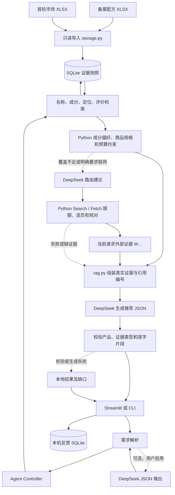

# 项目架构

`imports` 记录数据集和文件哈希。 `records` 以来源数据集、表和 Excel 行号组成稳定自然键，保留规范化查找字段以及整行字段 JSON。 `product_id` 和类型构成索引。词项检索在 17 个产品上用加权名称、成分、定位和评价命中，优先使用明确的产品名或产品 ID。消费者评价与分析通过上游 `review_id` 对齐。

每份证据使用当前快照中的 `E<row id>`。证据包包括可用的配方、官网、评价、商品和价格记录及来源元数据，按类型限制条数和长字段长度，引用回查展示完整原记录。生成结果只接受本次证据包中的合格产品和同产品引用，引用片段必须在允许的原字段中出现。样本计数、版本限制、价格和 URL 由程序生成。语义解读仍待核实。

预算放行需要人民币核实报价、带时区的时间、有效来源 URL，以及同产品下已核实的同平台商品 ID 和可解析的匹配规格。当前快照无符合这一口径的报价。现有数据库表无需迁移。

## 评价来源分流

公开快照保留评价来源和汇总标注，移除了未确认再分发授权的原文。读取时补齐旧快照的评价来源字段。显式标注优先。生产检索和证据编号回查使用同一白名单，RAG 请求保留 `source_type` 并标明 `production`。本地样本计数在过滤之后计算。RAG 仅检索有原文的评价，因此公开快照中的评价不作为引文传入。

## V1.2 外部证据路径

`web_tools.py` 提供覆盖检查、DeepSeek 动作校验、Search 结果筛选和 Fetch 正文提取。复用试点的官方 HTTP 传输。运行时以域名、标题、网页正文标题和请求词筛选。市场依据页面地址，规格从可关联标题读取。京东 SKU 只有在链接和正文明确商品编号一致时才记录。未确认的版本、报价及评价留缺口。

`agent.py` 保留本地硬规则，合格的外部官网证据可与本地证据进入同一次 `rag.py` 调用。证据查找和输出校验使用本轮字典，网页来源不会改写本地记录。外部候选的报价和评价仍采用保守口径，禁止借用其他 SKU 或地区数据。工具网络阶段限一次 Search 和两次 Fetch、无自动重试，每次受超时和截止时间约束。页面分别展示 Search / Fetch 估算费用与聊天请求返回的 token 计数。

`test_fixtures` 由测试代码单独加载，测试生成使用 `simulation` 证据包和 Mock。校验阻止模拟引用进入正式模式，且不接受把模拟样本描述为真实消费者体验的输出。Streamlit 无模拟开关。
