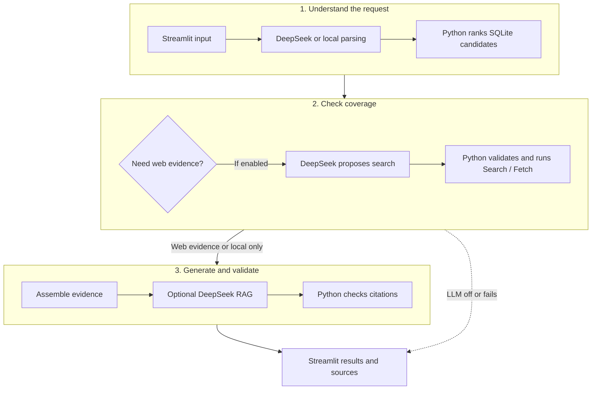

# AI Hair Care Assistant

A Chinese-language **AI product prototype** for shoppers comparing hair-care products across scalp needs, hair condition, ingredients, and budget. It turns a question such as “头皮容易出油，头发细软塌，预算 100 元以内” into a shortlist with traceable sources and explicit evidence gaps.

**[Read the product case study · 8-page Chinese PDF](docs/ai-hair-care-assistant-portfolio.pdf)** · [Run locally](#run-locally)

## Product problem and my role

The target users are shoppers who have a defined care need but have to piece together ingredient lists, brand claims, and prices across sources. The core scenario is choosing a product for a specific need, checking why a candidate matched, and seeing which details still require verification.

I led the product design and development practice for this individual project, using Codex as a development assistant. I scoped the MVP around traceable selection, evidence checks, and graceful fallback so that a useful local result survives network or model failures.

**Why an AI Agent?** A language model can structure a free-form question and propose a search when the catalog lacks evidence. A Python controller determines when that step is allowed, executes the approved tools, and enforces source, product, and budget rules.

## Implemented

| Capability | What the prototype does |
| --- | --- |
| Natural-language demand parsing | Extracts scalp needs, hair condition, goals, ingredient preferences, and budget. A local rules parser is available without a key and serves as fallback. |
| Local product retrieval | Ranks candidates from a bundled SQLite knowledge base. Python checks ingredient conflicts and requires a verified RMB quote for the matching SKU and specification before marking a budget match. |
| DeepSeek API and RAG | Combines **rule-based retrieval + evidence-grounded generation**. When enabled, DeepSeek generates explanations from retrieved evidence. Python checks citations against product IDs and source excerpts. |
| Agent Tool Calling | With web search enabled and a coverage gap or explicit web request, DeepSeek can propose a structured search action. Python validates it and runs up to **one Search and two Fetch calls** per request. |
| Streamlit interface and fallback | Shows candidate comparisons, source links, citation checks, tool status, and evidence gaps. Local results remain available if network tools or generation fail. Feedback is stored locally. |

## Architecture



Python owns the coverage check, execution limits, source selection, and validation. Failed web calls leave local evidence available. Failed or rejected model claims leave the relevant results and evidence visible. See the [detailed architecture](ARCHITECTURE.md) and [product requirements](PRD.md).

## Product iterations

| Version | Problem addressed | Implemented change |
| --- | --- | --- |
| **V1.0 · MVP** | Shoppers need to turn a free-form concern into comparable options. | Built a local Streamlit flow for retrieval, ingredient and budget checks, comparisons, and feedback. |
| **V1.1 · Evidence-grounded RAG** | A recommendation is hard to assess if its supporting evidence is hidden. | Added optional DeepSeek explanations backed by retrieved evidence, with source IDs and citation validation. |
| **V1.2 · Agent tool integration** | A fixed catalog cannot answer every request. | Added gated Search / Fetch, source selection, tool status, and claim-level validation that preserves usable evidence when a step fails. |

## Data and evaluation

- **17 products** in the fixed local catalog.
- **293 structured rows** across product and evidence records, collection logs, archives, and candidate tables.
- **74 automated tests passed, 2 skipped by default.** The two skipped tests require live API access. The suite checks retrieval, citation validation, fallback, and Streamlit behavior.
- **12 out-of-catalog candidates** returned page evidence in a historical Search / Fetch pilot. They remain unverified and were kept outside the bundled catalog.

The public snapshot retains source metadata and derived labels for **10 review samples across 7 products**. Review quotations are omitted. Prices are point-in-time observations, and the snapshot has no verified same-specification RMB offers that meet the strict budget rule. External evidence may still have market or SKU gaps. See the [evaluation notes](EVALUATION.md).

## Product walkthrough


*Screenshot from the local Streamlit app. It shows a submitted query, a matched candidate, and the review evidence panel with a source link.*

## Run locally

Use Python 3.12 from the repository root in PowerShell.

```powershell
python -m venv .venv
.\.venv\Scripts\python.exe -m pip install -r requirements.txt
.\.venv\Scripts\python.exe -m streamlit run app.py
```

Open the URL printed by Streamlit, usually `http://127.0.0.1:8501` on your own machine. The included SQLite snapshot supports local use without an API key.

```powershell
.\.venv\Scripts\python.exe cli.py "头皮容易出油，头发细软塌，预算 100 元以内"
.\.venv\Scripts\python.exe -m unittest discover -v
```

For optional DeepSeek features, copy [`.env.example`](.env.example) to `.env` and set your own `DEEPSEEK_API_KEY`. Restart and enable the LLM option. Web search has a separate toggle. Online calls send the query and relevant evidence to the configured provider and may incur charges. Git ignores `.env`. Use the empty example file as the shareable configuration template.

`render_search_pilot.py` is a historical evaluation utility that requires archived pilot captures and annotations.

## Roadmap

- Expand from 17 products toward **200 planned products** in stages, with more matched review metadata and verified quotes.
- Improve SKU and market-version matching.
- Evaluate usefulness, evidence coverage, latency, and cost across a wider range of queries before considering a hosted release.
